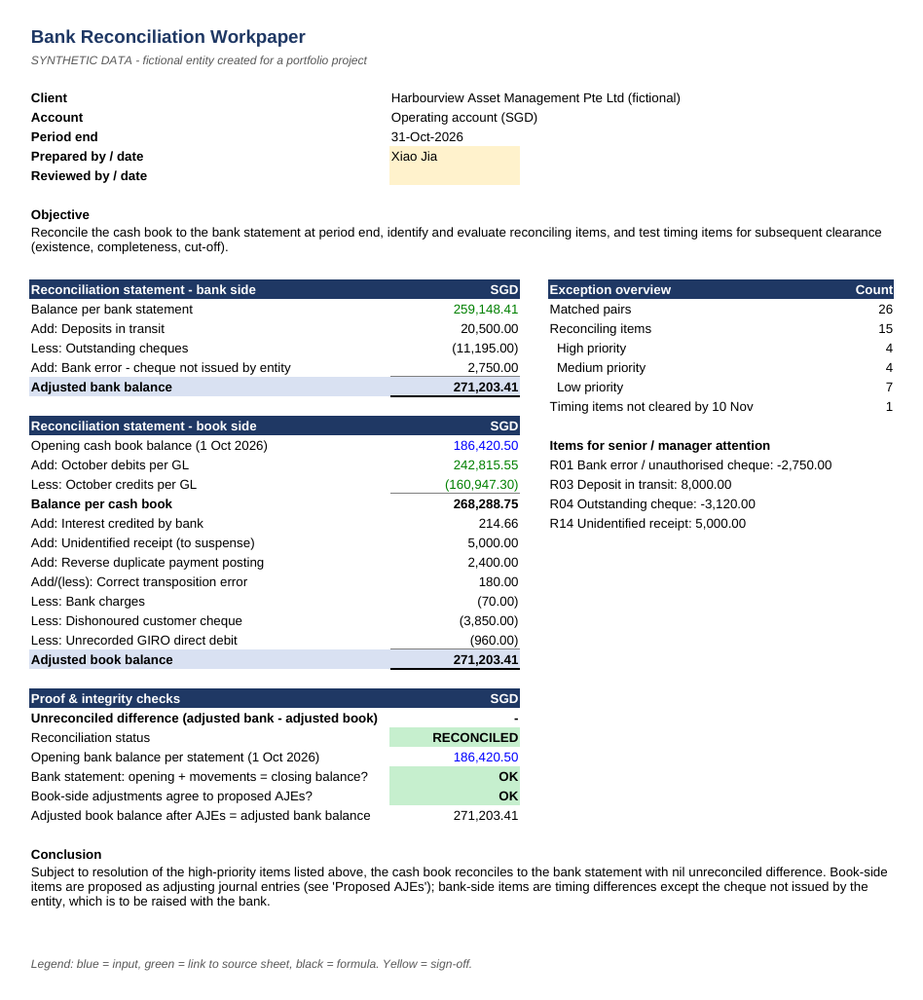

# Bank Reconciliation Automation — with Audit-Style Workpaper

A Python tool that reconciles a company's cash book (general ledger) to its bank statement, classifies every reconciling item, tests month-end timing items against the next month's bank statement, and produces an Excel workpaper in the format an auditor would review.

> **All data is synthetic.** The company (*Harbourview Asset Management Pte Ltd*), its funds, clients, vendors and amounts are fictional and generated by [`scripts/generate_sample_data.py`](scripts/generate_sample_data.py).



---

## Why I built this

During my accounting internship I reconciled bank records to ledger entries by hand. The work was mostly matching lines, and the judgement was in the few items that didn't match. This project automates the matching so attention goes to the exceptions, and it adds the audit procedures I studied (subsequent clearance, cut-off, escalation by threshold) on top of a basic reconciliation.

## What it does

| Step | What happens | Why it matters |
|---|---|---|
| 1. Load | Reads the GL cash account, the October bank statement and a 1–10 November statement | Uses the same source documents an auditor would request |
| 2. Duplicate check | Flags GL postings with the same reference and amount | Catches double-recorded payments |
| 3. Match | Three passes (below) pair GL lines with bank lines one-to-one | Most lines clear automatically |
| 4. Classify | Every unmatched line is assigned a category, the side to adjust (bank or book), a proposed entry and a follow-up action | Turns a list of differences into an action list |
| 5. Subsequent clearance | Deposits in transit and outstanding cheques are traced to the November statement | Tests existence and cut-off of timing items |
| 6. Prove | Builds the reconciliation statement and checks adjusted bank = adjusted book | Nil unreconciled difference, or the tool says *INVESTIGATE* |
| 7. Export | Writes an Excel workpaper with live formulas | A reviewer can trace each number to its source line |

### Matching logic

| Pass | Rule | Example |
|---|---|---|
| 1 | Cheque number **and** exact amount | GL `CHQ100231` ↔ bank `CHEQUE 100231`, both 486.20 |
| 2 | Exact amount, date within ±3 days, closest date wins | Two Nimbustech payments of 4,500.00 (8 Oct and 22 Oct) each match their own bank line |
| 3 | Cheque number agrees but amount differs → matched but flagged | Cheque 100236 booked 1,530.00, cleared 1,350.00 |

Cheque numbers are the only identifier shared by the books and the bank, so transfers and GIRO payments are matched on amount and date.

### Results on the sample data

The bank statement shows **SGD 259,148.41**, the cash book shows **SGD 268,288.75**, and after adjustments both come to **SGD 271,203.41**, a nil difference. The tool found all 15 planted reconciling items:

| Category | Side adjusted | Items | Amount (SGD) | Treatment |
|---|---|---:|---:|---|
| Deposits in transit | Bank | 2 | 20,500.00 | Timing; one banked 9 days after period end → **cut-off risk** |
| Outstanding cheques | Bank | 3 | (11,195.00) | Timing; cheque 100239 **still not presented** by 10 Nov |
| Cheque not issued by the entity | Bank | 1 | 2,750.00 | Outside the cheque book range → **bank error / possible fraud** |
| Interest not recorded | Book | 1 | 214.66 | Record interest income |
| Unidentified receipt | Book | 1 | 5,000.00 | Record to suspense, trace the remitter |
| Duplicate posting | Book | 1 | 2,400.00 | Reverse the duplicate journal |
| Transposition error | Book | 1 | 180.00 | Difference divisible by 9; correct to the cheque's face value |
| Bank charges | Book | 3 | (70.00) | Record bank charges |
| Dishonoured cheque | Book | 1 | (3,850.00) | Reinstate the receivable and assess recoverability |
| Unrecorded GIRO debit | Book | 1 | (960.00) | Obtain the mandate and invoice before recording |

Items at or above the escalation threshold (default SGD 5,000, adjustable), and items such as unidentified receipts or uncleared cheques, are marked **High priority**. Timing items already proven by subsequent clearance are not escalated.

## The Excel workpaper

`output/bank_reconciliation_workpaper_oct2026.xlsx`

| Sheet | Contents |
|---|---|
| **Summary** | Header and sign-off boxes, objective, reconciliation statement (SUMIFS formulas linked to the detail sheets), proof checks, high-priority items, conclusion |
| **Exceptions** | Every reconciling item with category, side, proposed entry, follow-up action and priority |
| **Proposed AJEs** | Double-entry adjusting journals for book-side items; checks that debits = credits and that the net cash effect agrees to the reconciliation |
| **Subsequent Clearance** | When each timing item cleared in November, or *NOT CLEARED* |
| **Matched** | All matched pairs with the match method and days apart |
| **GL_Oct / Bank_Oct / Bank_Nov** | Source data |

Formatting follows a common modelling convention: blue = input, green = link to another sheet, black = formula.

## Audit relevance

| Assertion | How the tool addresses it |
|---|---|
| **Existence** | Deposits in transit are traced to the next bank statement. A receipt that never arrives is flagged. |
| **Completeness** | Bank-only items (charges, interest, GIRO debits, dishonoured cheques) show what the books are missing. |
| **Cut-off** | Receipts recorded on 31 Oct but banked more than 5 days later are flagged as possible window dressing. |
| **Accuracy** | Amount mismatches are flagged, with a divisible-by-9 hint for transposition errors. |
| **Fraud risk indicators** | Cheques outside the entity's cheque book, unidentified receipts and long-outstanding cheques are escalated. |

## How to run

You need **Python 3.9+**.

```bash
# 1. Install dependencies
pip install -r requirements.txt

# 2. (Optional) regenerate the synthetic data
python scripts/generate_sample_data.py

# 3. Run the reconciliation
python main.py --preparer "Your Name"

# Options
python main.py --threshold 10000          # change the escalation threshold

# 4. Run the tests
python -m pytest -v
```

Console output:

```
Balance per bank statement       259,148.41
  bank-side adjustments           12,055.00
Adjusted bank balance            271,203.41
Balance per cash book            268,288.75
  book-side adjustments            2,914.66
Adjusted book balance            271,203.41
Unreconciled difference                0.00
...
Status: RECONCILED
```

## Project structure

```
bank-reconciliation-automation/
├── bankrec/
│   ├── reconcile.py        # loading, matching, classification, clearance, proof
│   └── workpaper.py        # Excel workpaper export
├── data/                   # synthetic GL, bank statements, config.json
├── docs/                   # screenshot used in this README
├── output/                 # generated workpaper and CSV reports
├── scripts/
│   └── generate_sample_data.py
├── tests/
│   └── test_reconcile.py   # 12 tests against the known answer key
├── main.py
└── requirements.txt
```

## Limitations

- **Rule-based.** Bank-only items are classified by keywords in the bank description, and a real bank's wording would need its own rules.
- **One-to-one matching only.** A single bank deposit covering several receipts (batched deposits) is not yet handled.
- **The proposed entries are suggestions.** Counter-accounts are mapped by category, and each entry still needs supporting documents and client approval.
- **Single account and currency.** No foreign-exchange revaluation or multi-account reconciliation.
- **It does not replace judgement.** The tool shows *where* to look. Deciding whether an item is an error, a timing difference or something worse still needs a person.

## Possible extensions

- Many-to-one matching for batched deposits
- Fuzzy matching on payee names
- Ageing analysis of outstanding items over several months
- Reading bank statements in CSV formats used by different banks

## License

MIT, see [LICENSE](LICENSE).
